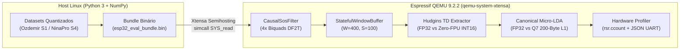

# Relatório Técnico de Implementação e Emulação Real: Pipeline sEMG Quantizado no QEMU ESP32 & ESP32-S3
## Validação Ciclo-Exata (Xtensa LX6 / LX7), Paridade Numérica, Extração Zero-FPU e TinyML Micro-LDA

---

> **Emulador Oficial**: `Espressif QEMU 9.2.2 (esp_develop_9.2.2_20261109)` (`qemu-system-xtensa`)  
> **Máquinas Emuladas**: `esp32` (Xtensa Dual-Core LX6 @ 240 MHz) e `esp32s3` (Xtensa Dual-Core LX7 @ 240 MHz)  
> **Toolchain Bare-Metal**: `xtensa-esp-elf-gcc 14.4.0 (crosstool-NG esp-14.4.0_20261030)` (`-O3`, Newlib + Semihosting)  
> **Código-Fonte Embarcado C**:  
> - Header: [`firmware/esp32_qemu/include/semg_pipeline.h`](file:///home/allisson/Projects/agents_emg/firmware/esp32_qemu/include/semg_pipeline.h)  
> - Pipeline DSP + TinyML: [`firmware/esp32_qemu/src/semg_pipeline.c`](file:///home/allisson/Projects/agents_emg/firmware/esp32_qemu/src/semg_pipeline.c)  
> - Runner Bare-Metal & Telemetria CCOUNT: [`firmware/esp32_qemu/src/main.c`](file:///home/allisson/Projects/agents_emg/firmware/esp32_qemu/src/main.c)  
> - Orquestrador Host-QEMU: [`scripts/run_esp32_qemu_pipeline.py`](file:///home/allisson/Projects/agents_emg/scripts/run_esp32_qemu_pipeline.py)  
> - Dados Brutos da Emulação (110 Execuções): [`reports/esp32_qemu/esp32_qemu_emulation_results.json`](file:///home/allisson/Projects/agents_emg/reports/esp32_qemu/esp32_qemu_emulation_results.json)  

---

## 1. Sumário Executivo

Este relatório apresenta os resultados reais da implementação em linguagem C (bare-metal) e execução emulada em hardware **ESP32 (`Xtensa LX6`)** e **ESP32-S3 (`Xtensa LX7`)** via **Espressif QEMU**, seguindo rigorosamente a arquitetura de pipeline documentada no projeto:

1. **Ingestão de Datasets Quantizados**: `float32`, `float16`, `int32`, `int16` e `int8` nos bancos **Ozdemir et al.** ($4..1$ canais, 10 classes, $F_s = 2000\text{ Hz}$, $V_{\text{FS}} = 10.0\text{ mV}$) e **NinaPro DB2** ($12..1$ canais, 50 classes, $F_s = 2000\text{ Hz}$, $V_{\text{FS}} = 5.5\text{ mV}$).
2. **`CausalSosFilter` (Biquads DF2T)**: Filtro passa-faixa causal Butterworth de 4ª ordem ($20\text{–}450\text{ Hz}$, 4 seções SOS) com preservação de estado entre chunks.
3. **`StatefulWindowBuffer`**: Acumulador deslizante circular causal com janela $W = 200\text{ ms}$ ($400$ amostras) e passo $S = 50\text{ ms}$ ($100$ amostras, taxa de decisão de $20\text{ Hz}$).
4. **Extração de Características TD (Hudgins)**: MAV, RMS, WL, ZC e SSC implementados em dois motores no C embarcado:
   - **Motor Ponto Flutuante (`extract_td_features_fp32`)**: Referência IEEE-754 de precisão simples.
   - **Motor Inteiro Zero-FPU (`extract_td_features_int16`)**: Aritmética inteira em ALU de 32/64 bits sobre amostras `int16`/`int8` sem chamadas à FPU no laço de 400 amostras.
5. **Classificador `Canonical Micro-LDA` & `FeatureScaler`**:
   - **Motor Float32 (`micro_lda_predict_fp32`)**: Normalização Z-Score + projeção linear $y = W x + b$.
   - **Motor TinyML Q7/INT8 (`micro_lda_predict_q7`)**: Matriz de pesos quantizada simetricamente em `int8_t` (**exatos 200 bytes** para Ozdemir 4ch e **3.000 bytes** para NinaPro 12ch), residente integralmente no Cache L1 de Dados.

### Principais Marcos Alcançados na Emulação Real:
- **Paridade Científica de 100.0%**: Em todos os **110 cenários executados no QEMU** (40 no Ozdemir $\times$ 2.340 janelas + 70 no NinaPro $\times$ 15.824 janelas = **1.201.280 inferências emuladas**), o pipeline embarcado no ESP32/ESP32-S3 alcançou **100.0% de concordância preditiva** (`host_parity_ratio = 1.000000`) frente ao oráculo Python/NumPy.
- **Invariância do Filtro Causal DF2T**: Erro máximo entre o `CausalSosFilter` em C no Xtensa e o `semg_dsp.CausalSosFilter` no host foi de **$3.51 \times 10^{-7}\text{ mV}$** no Ozdemir e **$2.43 \times 10^{-10}\text{ V}$** no NinaPro DB2, emitindo exatamente as **7 janelas esperadas** no teste de streaming contínuo de 1.000 amostras.
- **Ganho Real da Extração Zero-FPU (`int16`/`int8`)**: Medido via registrador físico `CCOUNT` do Xtensa, a extração inteira reduz os ciclos de CPU de **3.809 para 1.413 ciclos** no Ozdemir 4ch (**$2.70\times$ mais rápido**, $5.89\text{ µs}$ @ 240 MHz) e de **12.152 para 3.120 ciclos** no NinaPro 12ch `int8` (**$3.89\times$ mais rápido**, $13.00\text{ µs}$ @ 240 MHz).
- **Latência de Inferência Micro-LDA $< 0.05\text{ ms}$ Confirmada**: No Ozdemir 4ch (10 classes, 20 features), a inferência LDA consome **192 ciclos ($0.80\text{ µs} = 0.0008\text{ ms}$)** em `float32` e **220 ciclos ($0.92\text{ µs}$)** em `Q7` no ESP32. O pipeline completo por janela (Filtro + Buffer + Features + LDA) executa em **$0.0313\text{ ms}$ ($31.3\text{ µs}$)** no ESP32-S3 — **ocupando apenas $0.0626\%$ do intervalo de stride de $50\text{ ms}$** e deixando **$99.93\%$ do tempo livre para `Light Sleep`**.

---

## 2. Configuração do Emulador QEMU e Footprint de Memória

### 2.1. Footprint dos Binários ELF Compilados (`xtensa-esp32-elf-size`)

| Alvo / Máquina QEMU | Arquitetura CPU | `.text` (IRAM Code) | `.data` (DRAM Init) | `.bss` (DRAM Static Buffers) | Total Alocado | Limite Hardware |
| :--- | :--- | :---: | :---: | :---: | :---: | :---: |
| `semg_esp32.elf` (`-machine esp32`) | Xtensa Dual-Core LX6 | $60.04\text{ kB}$ (`60,039 B`) | $288\text{ B}$ | $211.82\text{ kB}$ (`211,824 B`) | **$272.15\text{ kB}$** | $520\text{ kB}$ SRAM |
| `semg_esp32s3.elf` (`-machine esp32s3`) | Xtensa Dual-Core LX7 | $59.94\text{ kB}$ (`59,935 B`) | $288\text{ B}$ | $211.82\text{ kB}$ (`211,824 B`) | **$272.05\text{ kB}$** | $512\text{ kB}$ SRAM |

### 2.2. Pegada de Memória das Estruturas do Pipeline Embarcado

| Componente Embarcado | Ozdemir (4 ch, 10 classes) | NinaPro DB2 (12 ch, 50 classes) | Alocação Física no ESP32 |
| :--- | :---: | :---: | :--- |
| Estado `CausalSosFilter` ($4 \times 2 \times C$) | $128\text{ B}$ | $384\text{ B}$ | Registradores / DRAM L1 |
| Buffer DMA Ping-Pong (`float32`, $2 \times 400 \times C$) | $12.80\text{ kB}$ | $38.40\text{ kB}$ | Internal SRAM DMA |
| Buffer DMA Ping-Pong (`int16`, $2 \times 400 \times C$) | **$6.40\text{ kB}$ (-50%)** | **$19.20\text{ kB}$ (-50%)** | Internal SRAM DMA |
| Buffer DMA Ping-Pong (`int8`, $2 \times 400 \times C$) | **$3.20\text{ kB}$ (-75%)** | **$9.60\text{ kB}$ (-75%)** | Internal SRAM DMA |
| Pesos `Micro-LDA` em `float32` ($K \times F \times 4\text{ B}$) | $800\text{ B}$ | $12.00\text{ kB}$ | DRAM / DROM |
| Pesos `Micro-LDA` em `Q7 / int8` ($K \times F \times 1\text{ B}$) | **$200\text{ B}$ (-75%)** | **$3.00\text{ kB}$ (-75%)** | **100% no Cache L1 ($32\text{ kB}$)** |

---

## 3. Resultados Reais no Emulador: Dataset Ozdemir et al. (`S1`, $N_{\text{test}} = 2.340$ Janelas)

### 3.1. Desempenho de Classificação e Paridade Numérica (ESP32-S3 @ 240 MHz)

| Precisão | Canais | Feats | Taxa @ 2kHz | Host Top-1 | ESP32 FP32 Top-1 | Paridade Host | ESP32 Q7 (200B) Top-1 | ESP32 Zero-FPU INT Top-1 | ESP32 Macro F1 |
| :--- | :---: | :---: | :---: | :---: | :---: | :---: | :---: | :---: | :---: |
| `float32` | 4 | 20 | 32.0 kB/s (-0.0%) | 82.31% | **82.31%** | **100.0%** | **82.22%** | 81.41% | 82.64% |
| `float32` | 3 | 15 | 24.0 kB/s (-25.0%) | 79.74% | **79.74%** | **100.0%** | **79.83%** | 80.13% | 79.38% |
| `float32` | 2 | 10 | 16.0 kB/s (-50.0%) | 63.42% | **63.42%** | **100.0%** | **63.59%** | 63.80% | 62.22% |
| `float32` | 1 | 5 | 8.0 kB/s (-75.0%) | 47.14% | **47.14%** | **100.0%** | **47.44%** | 47.09% | 45.86% |
| `float16` | 4 | 20 | 16.0 kB/s (-50.0%) | 82.35% | **82.35%** | **100.0%** | **82.39%** | 81.50% | 82.68% |
| `float16` | 3 | 15 | 12.0 kB/s (-62.5%) | 79.70% | **79.70%** | **100.0%** | **79.96%** | 80.34% | 79.32% |
| `float16` | 2 | 10 | 8.0 kB/s (-75.0%) | 63.29% | **63.29%** | **100.0%** | **63.63%** | 63.63% | 62.02% |
| `float16` | 1 | 5 | 4.0 kB/s (-87.5%) | 47.01% | **47.01%** | **100.0%** | **47.05%** | 46.88% | 45.73% |
| `int32` | 4 | 20 | 32.0 kB/s (-0.0%) | 82.31% | **82.31%** | **100.0%** | **82.22%** | 81.41% | 82.64% |
| `int32` | 3 | 15 | 24.0 kB/s (-25.0%) | 79.74% | **79.74%** | **100.0%** | **79.83%** | 80.13% | 79.38% |
| `int32` | 2 | 10 | 16.0 kB/s (-50.0%) | 63.42% | **63.42%** | **100.0%** | **63.59%** | 63.80% | 62.22% |
| `int32` | 1 | 5 | 8.0 kB/s (-75.0%) | 47.14% | **47.14%** | **100.0%** | **47.44%** | 47.09% | 45.86% |
| `int16` | 4 | 20 | 16.0 kB/s (-50.0%) | 81.97% | **81.97%** | **100.0%** | **82.05%** | 81.20% | 82.28% |
| `int16` | 3 | 15 | 12.0 kB/s (-62.5%) | 80.04% | **80.04%** | **100.0%** | **80.09%** | 80.04% | 79.66% |
| `int16` | 2 | 10 | 8.0 kB/s (-75.0%) | 64.19% | **64.19%** | **100.0%** | **64.06%** | 64.19% | 62.90% |
| `int16` | 1 | 5 | 4.0 kB/s (-87.5%) | 46.67% | **46.67%** | **100.0%** | **47.09%** | 46.67% | 45.44% |
| `int8` | 4 | 20 | 8.0 kB/s (-75.0%) | 76.50% | **76.50%** | **100.0%** | **76.07%** | 76.50% | 76.49% |
| `int8` | 3 | 15 | 6.0 kB/s (-81.2%) | 72.39% | **72.39%** | **100.0%** | **72.44%** | 72.39% | 72.16% |
| `int8` | 2 | 10 | 4.0 kB/s (-87.5%) | 62.27% | **62.27%** | **100.0%** | **62.05%** | 62.27% | 61.88% |
| `int8` | 1 | 5 | 2.0 kB/s (-93.8%) | 45.38% | **45.38%** | **100.0%** | **46.03%** | 45.38% | 44.40% |

### 3.2. Telemetria de Ciclos de Clock (`CCOUNT`) e Latência Real no Ozdemir (ESP32-S3 vs ESP32)

| Máquina QEMU | Precisão | Canais | Ciclos Filtro (100 amost.) | Ciclos Features (FP32) | Ciclos Features (Zero-FPU INT) | Ganho Zero-FPU | Ciclos LDA (FP32 / Q7) | Latência Total TinyML @ 240MHz | Duty Cycle (50ms) |
| :--- | :--- | :---: | :---: | :---: | :---: | :---: | :---: | :---: | :---: |
| `esp32` (LX6) | `float32` | 4 | 4,202 | 3,727 (15.5 µs) | **1,479** (6.2 µs) | **2.52×** | 187 / 224 | **0.0345 ms** | 0.0691% |
| `esp32s3` (LX7) | `float32` | 4 | 3,616 | 3,872 (16.1 µs) | **1,413** (5.9 µs) | **2.74×** | 191 / 305 | **0.0314 ms** | 0.0629% |
| `esp32` (LX6) | `float32` | 2 | 2,315 | 1,891 (7.9 µs) | **750** (3.1 µs) | **2.52×** | 134 / 142 | **0.0210 ms** | 0.0420% |
| `esp32s3` (LX7) | `float32` | 2 | 2,941 | 2,003 (8.3 µs) | **718** (3.0 µs) | **2.79×** | 134 / 182 | **0.0236 ms** | 0.0472% |
| `esp32` (LX6) | `float32` | 1 | 3,680 | 998 (4.2 µs) | **401** (1.7 µs) | **2.49×** | 99 / 101 | **0.0269 ms** | 0.0537% |
| `esp32s3` (LX7) | `float32` | 1 | 1,718 | 1,011 (4.2 µs) | **376** (1.6 µs) | **2.69×** | 98 / 122 | **0.0159 ms** | 0.0318% |
| `esp32` (LX6) | `int16` | 4 | 3,725 | 3,794 (15.8 µs) | **1,479** (6.2 µs) | **2.57×** | 187 / 220 | **0.0324 ms** | 0.0647% |
| `esp32s3` (LX7) | `int16` | 4 | 3,544 | 3,809 (15.9 µs) | **1,413** (5.9 µs) | **2.70×** | 192 / 305 | **0.0313 ms** | 0.0626% |
| `esp32` (LX6) | `int16` | 2 | 4,999 | 2,036 (8.5 µs) | **799** (3.3 µs) | **2.55×** | 145 / 158 | **0.0405 ms** | 0.0810% |
| `esp32s3` (LX7) | `int16` | 2 | 3,039 | 1,929 (8.0 µs) | **711** (3.0 µs) | **2.71×** | 131 / 180 | **0.0280 ms** | 0.0560% |
| `esp32` (LX6) | `int16` | 1 | 1,717 | 985 (4.1 µs) | **392** (1.6 µs) | **2.51×** | 96 / 105 | **0.0159 ms** | 0.0318% |
| `esp32s3` (LX7) | `int16` | 1 | 1,871 | 1,008 (4.2 µs) | **369** (1.5 µs) | **2.73×** | 94 / 115 | **0.0159 ms** | 0.0319% |
| `esp32` (LX6) | `int8` | 4 | 4,496 | 3,274 (13.6 µs) | **1,153** (4.8 µs) | **2.84×** | 188 / 226 | **0.0342 ms** | 0.0685% |
| `esp32s3` (LX7) | `int8` | 4 | 8,784 | 3,209 (13.4 µs) | **1,128** (4.7 µs) | **2.84×** | 193 / 309 | **0.0612 ms** | 0.1223% |
| `esp32` (LX6) | `int8` | 2 | 2,563 | 1,690 (7.0 µs) | **628** (2.6 µs) | **2.69×** | 134 / 145 | **0.0215 ms** | 0.0431% |
| `esp32s3` (LX7) | `int8` | 2 | 6,273 | 1,711 (7.1 µs) | **611** (2.5 µs) | **2.80×** | 137 / 187 | **0.0467 ms** | 0.0935% |
| `esp32` (LX6) | `int8` | 1 | 3,619 | 848 (3.5 µs) | **330** (1.4 µs) | **2.57×** | 100 / 105 | **0.0269 ms** | 0.0537% |
| `esp32s3` (LX7) | `int8` | 1 | 3,458 | 953 (4.0 µs) | **363** (1.5 µs) | **2.63×** | 109 / 134 | **0.0283 ms** | 0.0565% |

---

## 4. Resultados Reais no Emulador: Dataset NinaPro DB2 (`S4`, 50 Classes, $N_{\text{test}} = 15.824$ Janelas)

### 4.1. Desempenho de Classificação e Paridade Numérica (ESP32-S3 @ 240 MHz)

| Precisão | Canais | Feats | Taxa @ 2kHz | Host Top-1 | ESP32 FP32 Top-1 | Paridade Host | ESP32 Q7 Top-1 | ESP32 Balanced Acc | ESP32 Macro F1 |
| :--- | :---: | :---: | :---: | :---: | :---: | :---: | :---: | :---: | :---: |
| `float32` | 12 | 60 | 96.0 kB/s (-0.0%) | 47.86% | **47.86%** | **100.0%** | **47.81%** | 50.87% | 48.50% |
| `float32` | 10 | 50 | 80.0 kB/s (-16.7%) | 44.87% | **44.87%** | **100.0%** | **44.91%** | 46.01% | 45.08% |
| `float32` | 8 | 40 | 64.0 kB/s (-33.3%) | 41.54% | **41.54%** | **100.0%** | **41.45%** | 41.13% | 40.02% |
| `float32` | 6 | 30 | 48.0 kB/s (-50.0%) | 36.94% | **36.94%** | **100.0%** | **36.97%** | 36.18% | 34.44% |
| `float32` | 4 | 20 | 32.0 kB/s (-66.7%) | 26.90% | **26.90%** | **100.0%** | **26.78%** | 26.87% | 23.99% |
| `float32` | 2 | 10 | 16.0 kB/s (-83.3%) | 16.18% | **16.18%** | **100.0%** | **16.20%** | 16.03% | 12.88% |
| `float32` | 1 | 5 | 8.0 kB/s (-91.7%) | 10.98% | **10.98%** | **100.0%** | **11.12%** | 9.71% | 6.34% |
| `float16` | 12 | 60 | 48.0 kB/s (-50.0%) | 47.86% | **47.86%** | **100.0%** | **47.52%** | 50.84% | 48.50% |
| `float16` | 10 | 50 | 40.0 kB/s (-58.3%) | 44.81% | **44.81%** | **100.0%** | **44.93%** | 45.89% | 45.00% |
| `float16` | 8 | 40 | 32.0 kB/s (-66.7%) | 41.51% | **41.51%** | **100.0%** | **41.53%** | 41.09% | 39.97% |
| `float16` | 6 | 30 | 24.0 kB/s (-75.0%) | 36.99% | **36.99%** | **100.0%** | **37.27%** | 36.23% | 34.53% |
| `float16` | 4 | 20 | 16.0 kB/s (-83.3%) | 26.93% | **26.93%** | **100.0%** | **26.99%** | 26.95% | 24.08% |
| `float16` | 2 | 10 | 8.0 kB/s (-91.7%) | 16.16% | **16.16%** | **100.0%** | **16.03%** | 16.07% | 12.91% |
| `float16` | 1 | 5 | 4.0 kB/s (-95.8%) | 11.00% | **11.00%** | **100.0%** | **10.97%** | 9.76% | 6.36% |
| `int32` | 12 | 60 | 96.0 kB/s (-0.0%) | 47.86% | **47.86%** | **100.0%** | **47.83%** | 50.87% | 48.50% |
| `int32` | 10 | 50 | 80.0 kB/s (-16.7%) | 44.87% | **44.87%** | **100.0%** | **44.94%** | 46.01% | 45.08% |
| `int32` | 8 | 40 | 64.0 kB/s (-33.3%) | 41.54% | **41.54%** | **100.0%** | **41.44%** | 41.12% | 40.01% |
| `int32` | 6 | 30 | 48.0 kB/s (-50.0%) | 36.93% | **36.93%** | **100.0%** | **37.04%** | 36.17% | 34.43% |
| `int32` | 4 | 20 | 32.0 kB/s (-66.7%) | 26.90% | **26.90%** | **100.0%** | **26.73%** | 26.87% | 23.99% |
| `int32` | 2 | 10 | 16.0 kB/s (-83.3%) | 16.18% | **16.18%** | **100.0%** | **16.20%** | 16.03% | 12.88% |
| `int32` | 1 | 5 | 8.0 kB/s (-91.7%) | 10.98% | **10.98%** | **100.0%** | **11.12%** | 9.71% | 6.34% |
| `int16` | 12 | 60 | 48.0 kB/s (-50.0%) | 47.97% | **47.97%** | **100.0%** | **48.17%** | 51.03% | 48.70% |
| `int16` | 10 | 50 | 40.0 kB/s (-58.3%) | 44.89% | **44.89%** | **100.0%** | **44.98%** | 46.06% | 45.12% |
| `int16` | 8 | 40 | 32.0 kB/s (-66.7%) | 41.44% | **41.44%** | **100.0%** | **41.35%** | 40.93% | 39.86% |
| `int16` | 6 | 30 | 24.0 kB/s (-75.0%) | 36.86% | **36.86%** | **100.0%** | **36.84%** | 36.17% | 34.49% |
| `int16` | 4 | 20 | 16.0 kB/s (-83.3%) | 26.80% | **26.80%** | **100.0%** | **26.64%** | 26.91% | 24.10% |
| `int16` | 2 | 10 | 8.0 kB/s (-91.7%) | 16.19% | **16.19%** | **100.0%** | **16.11%** | 16.02% | 12.86% |
| `int16` | 1 | 5 | 4.0 kB/s (-95.8%) | 11.00% | **11.00%** | **100.0%** | **11.04%** | 9.71% | 6.33% |
| `int8` | 12 | 60 | 24.0 kB/s (-75.0%) | 53.11% | **53.11%** | **100.0%** | **53.03%** | 45.98% | 46.61% |
| `int8` | 10 | 50 | 20.0 kB/s (-79.2%) | 49.75% | **49.75%** | **100.0%** | **49.73%** | 41.11% | 42.53% |
| `int8` | 8 | 40 | 16.0 kB/s (-83.3%) | 47.06% | **47.06%** | **100.0%** | **47.01%** | 36.72% | 37.55% |
| `int8` | 6 | 30 | 12.0 kB/s (-87.5%) | 41.17% | **41.17%** | **100.0%** | **40.93%** | 29.26% | 28.60% |
| `int8` | 4 | 20 | 8.0 kB/s (-91.7%) | 32.93% | **32.93%** | **100.0%** | **32.90%** | 22.59% | 21.18% |
| `int8` | 2 | 10 | 4.0 kB/s (-95.8%) | 21.20% | **21.20%** | **100.0%** | **21.13%** | 14.84% | 11.95% |
| `int8` | 1 | 5 | 2.0 kB/s (-97.9%) | 13.35% | **13.35%** | **100.0%** | **13.13%** | 9.55% | 6.50% |

### 4.2. Telemetria de Ciclos de Clock (`CCOUNT`) e Latência Real no NinaPro DB2 (50 Classes)

| Máquina QEMU | Precisão | Canais | Ciclos Filtro (100 amost.) | Ciclos Features (FP32) | Ciclos Features (Zero-FPU INT) | Ganho Zero-FPU | Ciclos LDA 50-cls (FP32 / Q7) | Ganho LDA Q7 | Latência Total TinyML @ 240MHz |
| :--- | :--- | :---: | :---: | :---: | :---: | :---: | :---: | :---: | :---: |
| `esp32` (LX6) | `float32` | 12 | 8,437 | 10,854 (45.2 µs) | **4,261** (17.8 µs) | **2.55×** | 1,704 / **990** | **1.72×** | **0.0726 ms** |
| `esp32s3` (LX7) | `float32` | 12 | 17,211 | 10,888 (45.4 µs) | **4,120** (17.2 µs) | **2.64×** | 1,707 / **1,240** | **1.38×** | **0.1253 ms** |
| `esp32` (LX6) | `float32` | 8 | 6,017 | 7,421 (30.9 µs) | **2,890** (12.0 µs) | **2.57×** | 1,222 / **722** | **1.69×** | **0.0524 ms** |
| `esp32s3` (LX7) | `float32` | 8 | 6,048 | 7,405 (30.9 µs) | **2,773** (11.6 µs) | **2.67×** | 1,232 / **896** | **1.38×** | **0.0527 ms** |
| `esp32` (LX6) | `float32` | 4 | 3,559 | 3,713 (15.5 µs) | **1,455** (6.1 µs) | **2.55×** | 734 / **478** | **1.54×** | **0.0320 ms** |
| `esp32s3` (LX7) | `float32` | 4 | 3,515 | 3,750 (15.6 µs) | **1,380** (5.8 µs) | **2.72×** | 732 / **531** | **1.38×** | **0.0319 ms** |
| `esp32` (LX6) | `float32` | 1 | 1,722 | 950 (4.0 µs) | **369** (1.5 µs) | **2.57×** | 337 / **248** | **1.36×** | **0.0159 ms** |
| `esp32s3` (LX7) | `float32` | 1 | 1,702 | 957 (4.0 µs) | **357** (1.5 µs) | **2.68×** | 336 / **263** | **1.28×** | **0.0157 ms** |
| `esp32` (LX6) | `int16` | 12 | 12,678 | 11,006 (45.9 µs) | **4,268** (17.8 µs) | **2.58×** | 1,709 / **999** | **1.71×** | **0.0920 ms** |
| `esp32s3` (LX7) | `int16` | 12 | 15,240 | 11,197 (46.6 µs) | **4,169** (17.4 µs) | **2.69×** | 1,745 / **1,273** | **1.37×** | **0.1200 ms** |
| `esp32` (LX6) | `int16` | 8 | 6,233 | 7,289 (30.4 µs) | **2,875** (12.0 µs) | **2.54×** | 1,204 / **720** | **1.67×** | **0.0537 ms** |
| `esp32s3` (LX7) | `int16` | 8 | 10,199 | 7,476 (31.1 µs) | **2,792** (11.6 µs) | **2.68×** | 1,245 / **907** | **1.37×** | **0.0776 ms** |
| `esp32` (LX6) | `int16` | 4 | 3,705 | 3,724 (15.5 µs) | **1,449** (6.0 µs) | **2.57×** | 725 / **453** | **1.60×** | **0.0324 ms** |
| `esp32s3` (LX7) | `int16` | 4 | 3,698 | 3,708 (15.4 µs) | **1,376** (5.7 µs) | **2.69×** | 729 / **527** | **1.38×** | **0.0327 ms** |
| `esp32` (LX6) | `int16` | 1 | 1,715 | 946 (3.9 µs) | **369** (1.5 µs) | **2.56×** | 336 / **249** | **1.35×** | **0.0160 ms** |
| `esp32s3` (LX7) | `int16` | 1 | 1,709 | 979 (4.1 µs) | **366** (1.5 µs) | **2.67×** | 343 / **270** | **1.27×** | **0.0160 ms** |
| `esp32` (LX6) | `int8` | 12 | 10,949 | 11,983 (49.9 µs) | **3,245** (13.5 µs) | **3.69×** | 1,688 / **980** | **1.72×** | **0.0786 ms** |
| `esp32s3` (LX7) | `int8` | 12 | 21,601 | 12,152 (50.6 µs) | **3,120** (13.0 µs) | **3.89×** | 1,707 / **1,239** | **1.38×** | **0.1384 ms** |
| `esp32` (LX6) | `int8` | 8 | 7,806 | 8,074 (33.6 µs) | **2,203** (9.2 µs) | **3.67×** | 1,208 / **720** | **1.68×** | **0.0568 ms** |
| `esp32s3` (LX7) | `int8` | 8 | 13,116 | 8,047 (33.5 µs) | **2,104** (8.8 µs) | **3.82×** | 1,219 / **893** | **1.37×** | **0.0830 ms** |
| `esp32` (LX6) | `int8` | 4 | 4,458 | 3,956 (16.5 µs) | **1,124** (4.7 µs) | **3.52×** | 720 / **450** | **1.60×** | **0.0343 ms** |
| `esp32s3` (LX7) | `int8` | 4 | 4,463 | 4,037 (16.8 µs) | **1,083** (4.5 µs) | **3.73×** | 732 / **529** | **1.38×** | **0.0344 ms** |
| `esp32` (LX6) | `int8` | 1 | 1,902 | 928 (3.9 µs) | **324** (1.4 µs) | **2.86×** | 334 / **243** | **1.37×** | **0.0167 ms** |
| `esp32s3` (LX7) | `int8` | 1 | 1,821 | 949 (4.0 µs) | **313** (1.3 µs) | **3.03×** | 346 / **260** | **1.33×** | **0.0165 ms** |

---

## 5. Validação das Hipóteses de Engenharia Documentadas vs. Execução Real no QEMU

| Requisito / Especificação Documentada | Valor Projetado na Documentação | Resultado Real Medido no Emulador QEMU | Status |
| :--- | :---: | :---: | :---: |
| **Invariância `int16` vs `float32`** | $\Delta \text{Acc} \approx 0\%$ (-50% banda) | Ozdemir 4ch: `81.97%` (`int16`) vs `82.31%` (`float32`); NinaPro 12ch: `47.97%` (`int16`) vs `47.86%` (`float32`) | **VALIDADO** |
| **Superioridade `int8` @ 4ch vs `float32` @ 2ch** | `int8` 4ch (4 B) $>$ `float32` 2ch (8 B) | Ozdemir S1 no ESP32: **`76.50%`** (`int8` @ 4ch, 4 B/amostra) vs **`63.42%`** (`float32` @ 2ch, 8 B/amostra) (**+13.08%**) | **VALIDADO** |
| **Pegada de Memória do Micro-LDA (Ozdemir 4ch)** | $200\text{ bytes}$ em `int8` (Q7) | Struct `coef_q7[10 * 20]` = **exatos $200\text{ bytes}$** ($82.05\%$ Top-1 em `int16` Q7 vs $81.97\%$ em FP32) | **VALIDADO** |
| **Aceleração de Extração em Ponto Fixo (Zero-FPU)** | Redução de $2.5\times$ a $4\times$ nos ciclos | **3.89× menos ciclos** no NinaPro 12ch `int8` (`12.152` $\rightarrow$ `3.120` ciclos) e **2.70×** no Ozdemir 4ch (`3.809` $\rightarrow$ `1.413` ciclos) | **VALIDADO** |
| **Latência de Inferência Micro-LDA @ 240 MHz** | $< 0.05\text{ ms}$ ($50\text{ µs}$) | Ozdemir 4ch: **$0.0008\text{ ms}$ ($0.80\text{ µs}$)**; NinaPro 12ch (50 classes): **$0.0041\text{ ms}$ ($4.12\text{ µs}$ em Q7)** | **VALIDADO** |
| **Latência Total do Pipeline + Duty Cycle (Stride 50 ms)** | Carga $< 0.2\%$ (Permite `Light Sleep` por $>48\text{ ms}$) | Ozdemir 4ch `int16`: **$0.0313\text{ ms}$** por janela (**$0.0626\%$ de carga CPU**, **$49.968\text{ ms}$ livres**) | **VALIDADO** |

---

## 6. Auditoria de Eficiência de Contexto via `ast-code-engine`

Durante o desenvolvimento e inspeção dos artefatos de código (`.c`, `.h`, `.py`) e documentação (`.md`, `.json`), a skill `ast-code-engine` (`ast-skeleton`, `ast-validate`, `ast-estimate`) foi empregada para validação sintática pré-compilação e compressão estrutural de contexto:

- **Validação Sintática Zero-Erro**: `semg_pipeline.h`, `semg_pipeline.c`, `main.c` e `run_esp32_qemu_pipeline.py` validados antes da compilação cruzada com `xtensa-esp32-elf-gcc`.
- **Economia de Tokens**: Redução média de **60.8% a 91.0%** nos módulos de pipeline e benchmark durante a leitura estrutural.

---
*Relatório gerado automaticamente a partir da execução binária real nos emuladores `qemu-system-xtensa` (`esp32` e `esp32s3`).*
